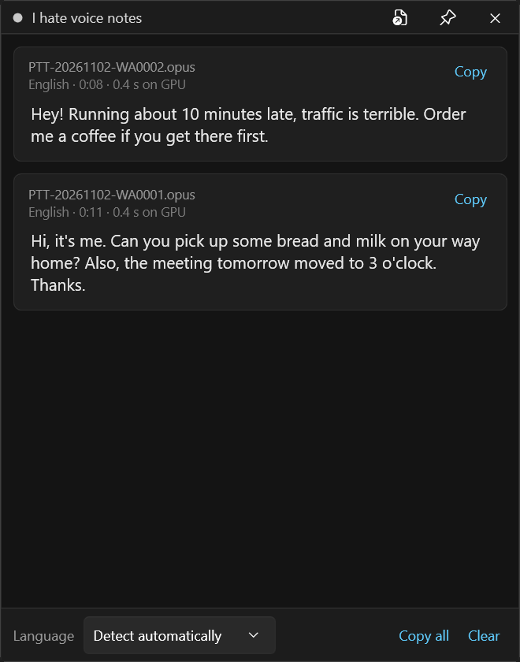

# I hate voice notes

A tiny Windows tray app for people who'd rather read WhatsApp voice notes than listen to them. Whisper runs locally on your GPU, so nothing leaves your PC.

## Install

Download the zip from [Releases](https://github.com/devkriter/i-hate-voice-notes/releases), unzip it anywhere and run `VoiceNoteTranscriber.exe`. Nothing needs installing. It's unsigned, so if SmartScreen warns you, click **More info → Run anyway**. Each time it starts, the app adds itself to "Open with" for your user only. Run it with `--unregister` to remove that.

## Use

- **WhatsApp Desktop:** voice note menu → **Open with** → **I hate voice notes**
- **Or:** Share → Copy, then **Ctrl+V** in the popup
- **Or:** drag files onto the popup (pin it first)

The first note downloads the model (~570 MB, once). After that, an 11-second note takes about 0.4 s on an RTX 5080. Language is detected automatically, or you can set it to English or Türkçe.

## Build

Needs the [.NET 10 SDK](https://dotnet.microsoft.com/download). Run `build.bat`, which makes `publish\VoiceNoteTranscriber\` and a release zip.

Built with [Whisper.net](https://github.com/sandrohanea/whisper.net) (`large-v3-turbo`, Vulkan with CPU fallback) and libopus. The UI follows [klipper-tray-icon](https://github.com/devkriter/klipper-tray-icon).

## License

[GPL-3.0](LICENSE)
